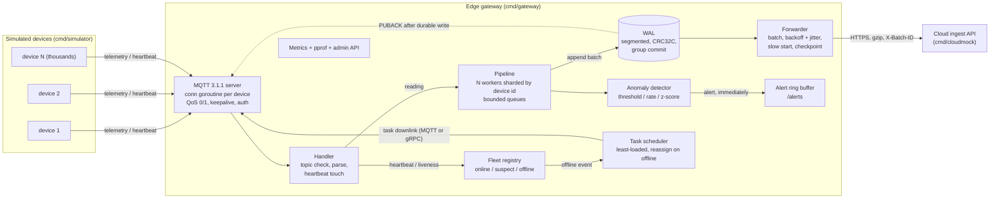

# Architecture

## Data flow



## Delivery guarantees

* A QoS 1 `PUBACK` is sent only after the reading's WAL batch has been written.
  Under `-sync=always` that means fsynced; under the default `interval` mode a
  power cut can lose at most `-sync-every` worth of acked data (process crashes
  lose nothing, the OS has the bytes).
* Upstream is **at-least-once**. Each batch carries `X-Batch-ID: <gw>:<first>-<last>`;
  the checkpoint is advanced only after a 2xx, so a crash between send and
  checkpoint replays the batch and the cloud dedupes on that id.
* Ordering is preserved per device (same shard worker, same WAL order).
* Disk is bounded (`-wal-max-mb`). When a long outage fills it, the **oldest**
  segments are dropped and counted in `edge_wal_evicted_total`.

## Store-and-forward

1. Ingest never talks to the network. It only appends to the WAL.
2. The forwarder owns a `wal.Reader` positioned at the checkpoint and wakes on
   a notify channel (or a 1s poll as safety net).
3. On failure it goes `offline`, shrinks the batch to the probe size
   (`-min-batch`) and sleeps `backoff * [0.5, 1.5)` (doubling, capped at 30s).
4. On success the batch size doubles each round up to `-max-batch` (slow start),
   so a recovering uplink is probed before it is flooded. `-catchup-rate`
   optionally caps drain speed.
5. Permanent rejections (400/413/422) are skipped and counted as dead-lettered;
   one poison batch never blocks the queue.
6. Fully forwarded segments are deleted (`TruncateBefore`).

## WAL format

```
segment file  <20-digit base index>.wal
record        | len u32 | crc32c u32 | payload |
payload       | ver | flags | ts i64 | recv i64 | value f64 | len+device | len+metric |
```

On open the last segment is scanned and truncated at the first torn or corrupt
record. Mid-log corruption makes the reader skip to the next segment
(`SkipCorrupt`) instead of wedging the uplink.

## Concurrency model

| Component | Model |
|---|---|
| MQTT server | goroutine per connection, 512B read buffer, per-session write mutex, atomic stats, `MaxConns` admission |
| Pipeline | N workers, one bounded channel each, device-id hash sharding; QoS 1 waits (with timeout) for queue space, QoS 0 is shed immediately |
| Group commit | a worker drains up to `MaxBatch` queued jobs, then does one `write` and (if configured) one `fsync` for all of them |
| WAL | single mutex around append; readers are lock-free file readers that snapshot the segment list before reading, so "newer segment exists" implies "this one is final" |
| Detector / Fleet | 64 lock-sharded maps |
| Metrics | atomic counters, lock-free log-linear histogram |
| Shutdown | stop accepting, close conns, drain pipeline, stop forwarder, final fsync |

## Anomaly detection

Per `(device, metric)` series, in order: hard min/max → rate of change →
z-score against a baseline that is Welford during warmup and EWMA afterwards.
Anomalous points do not update the baseline, but 5 in a row re-center it (a real
process shift should not alert forever). Alerts have a per-kind cooldown; the
reading itself is always flagged for the cloud. Rules: `deploy/rules.example.json`.

## Fleet

`online → suspect → offline` on silence (`-suspect-after`, `-offline-after`),
any message counts as liveness. On `offline` the scheduler moves that device's
tasks to the least-loaded online device (downlink over MQTT
`devices/<id>/tasks`, or the gRPC `Tasks` stream for devices that connect that way); with nobody available they stay pending and are placed
as soon as a device appears.

## Topics

| Topic | Direction | Payload |
|---|---|---|
| `devices/<id>/telemetry` | device → gw | `{"m":"engine_temp","v":91.2,"t":<unix µs>}` |
| `devices/<id>/heartbeat` | device → gw | any |
| `devices/<id>/tasks` | gw → device | task JSON (device must SUBSCRIBE) |

A device may only publish under its own id (client id must match), otherwise
the publish is refused and counted in `edge_messages_spoofed_total`.

## gRPC ingest

`edge.v1.Ingest/Stream` is a bidirectional stream: the device sends
`ReadingBatch{device_id, seq, readings[]}` and gets `Ack{seq, accepted, status}`
once the whole batch is durable (`SubmitMany` queues every reading, then waits,
so a batch costs about one group commit). `STATUS_OVERLOADED` / `INTERNAL` mean
resend; `STATUS_INVALID` means never resend. A partially accepted batch that is
resent can duplicate readings (at-least-once). Auth is `authorization: Bearer`
metadata and/or mTLS. Many streams share few HTTP/2 connections.

## TLS

`-tls-cert/-tls-key` turn on TLS for MQTT, gRPC and the admin API; adding
`-tls-client-ca` requires device certificates (mTLS). Certificates are
re-read on change (rotation without restart). TLS handshakes happen in the
per-connection goroutine under the connect timeout, so a handshake storm cannot
block the accept loop.

## Not done (on purpose)

* MQTT QoS 2, retained messages, persistent sessions.
